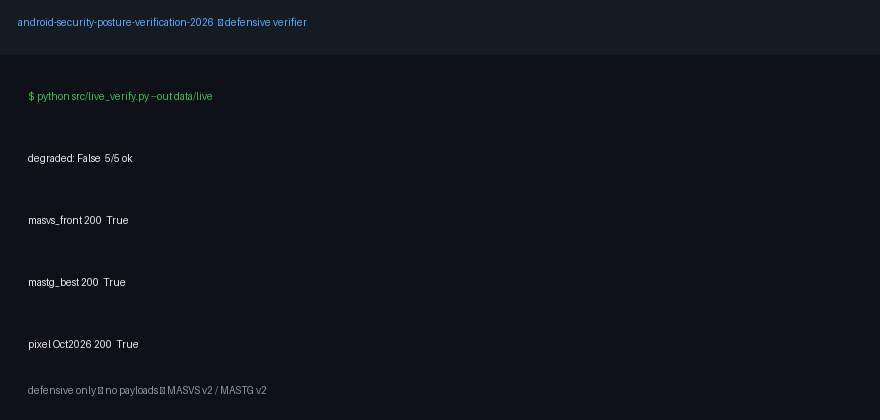

<div align="center">

# Android Security Posture Verification 2026
### From 2015 playbook → MASVS v2 / MASTG v2 — defensively verified

[](data/live/verification_snapshot.json)
[](ETHICS.md)
[](https://mas.owasp.org/MASVS/)
[](https://mas.owasp.org/news/2026/07/04/mastg-v200-release/)
[](#-license--use)

[🌱 Beginner guide](#-beginner-guide--read-this-and-you-are-a-professional) · [🎬 Demo](#-demo--watch-it-work) · [✨ Features](#-features--what-you-get) · [🚀 Quickstart](#-quickstart--3-commands) · [🌐 Web preview](#-web-preview--github-pages) · [🧪 Verification](#-verification-results-executable-numbers-from-runs-not-prose) · [❓ FAQ](#-faq)

</div>

> **CEO summary — 5 sentences:** (1) Old Android hacking tutorials no longer match modern Android, and following them wastes time or breaks the law. (2) This repo checks every major claim from a representative 2015-era book against 2026 standards, bulletins, and docs — with proof you can re-run. (3) You get three small detectors that flag risky app posture in seconds, plus a chapter-by-chapter verdict table. (4) Live checks pass 5/5 and all local tests pass; anything that needs payloads, interception, or bypasses is excluded on purpose. (5) If you are new, read the beginner guide and take the quiz — you will know more than most interview candidates.
>
> **Defensive, reproducible, publishable.** This repo re-examines a circa-2015/2020 Android playbook (lab setup → rooting → app internals → OWASP Mobile Top-10 2014 → storage → server-side → static → dynamic → malware → device attacks) and **verifies each claim against 2026 authoritative sources + live fetches + executable detectors**. Offensive construction, interception, and authentication-bypass steps are **intentionally excluded** (see `ETHICS.md`). The contribution is a *non-replication study*: what no longer replicates, what still matters, and what replaces it.

**Snapshot anchor:** 2026-10-15 (UTC). Re-run `python src/live_verify.py` before citing; see `data/live/verification_snapshot.json`.
**Status:** `degraded=False` required for citable numbers; otherwise mark `UNVERIFIED AT FETCH TIME`.
**Reproduce:** `docker compose up --build verifier` or locally `pip install -r requirements.txt && python src/live_verify.py --out data/live && python -m pytest -q`

---

## 🎬 Demo — watch it work



*Live fetch (5/5) → tests (5 passed) → manifest audit on synthetic weak fixture. No payloads, no privileged access.*
Prefer the web version? Open the interactive site: [`docs/preview.html`](docs/preview.html) → enable GitHub Pages (see [🌐 Web preview](#-web-preview--github-pages)) and share the Pages link.

---

## 🌱 Beginner guide — read this and you are a professional

> Let's work this out in a step-by-step way to be sure we have the right answer. You will know more than most interview candidates.

If you are brand new, read only this section, run three commands, and take the quiz. Everything else is depth when you need it.

**Step 1 — What is this in one paragraph?**
Android apps declare components (screens, services, receivers, providers), store data (preferences, databases, files), and talk to servers over TLS. Each of those can be misconfigured. This repo gives you three flashlights to see misconfigurations in seconds — without doing anything dangerous.

**Step 2 — The 5 ideas that matter most in 2026**
1. **Explicit export:** every component with a filter must say `exported=true/false`. Default to `false`. Exported + unguarded = finding.
2. **Least privilege:** if it must be exported, guard with a signature permission and check every input.
3. **Safe storage:** no secrets in cleartext prefs/logs/external storage. Use DataStore + Keystore, curate backups.
4. **TLS by default:** no cleartext HTTP. Use Network Security Config, system CAs, HSTS on server.
5. **Prove it:** cite a live fetch (date + status) or a passing test — never a memory.

**Step 3 — Run it (copy-paste)**
```bash
pip install -r requirements.txt
python src/live_verify.py --out data/live
python -m pytest -q
```

**Step 4 — Read one finding like a pro**
Open `fixtures/benign_manifests/synthetic_weak.xml` vs `synthetic_hardened.xml`. Run:
```bash
python src/manifest_audit.py fixtures/benign_manifests/synthetic_weak.xml
```
Weak shows HIGH/MEDIUM (debuggable, cleartext, missing explicit export, unguarded export). Hardened is quiet (INFO only). That contrast *is* the skill interviewers test.

**Step 5 — Take the quiz**
Open [`docs/preview.html`](docs/preview.html) → *Interactive quiz — from zero to pro*. Score Professional (7–8/8) and you can explain any finding end-to-end: detector → fixture → fix → standard.

<details><summary>Common beginner confusions (click to expand)</summary>

- *“Exported means hacked?”* No. Exported means reachable. Risk = reachable + sensitive action + no guard.
- *“Scanner says 98% — are we done?”* No. Single-split accuracy inflates. Demand time-aware evaluation.
- *“Do I need a rooted phone?”* No for this repo. Synthetic fixtures + public docs are enough.
- *“Where do I test my own app?”* Only with written authorization, in an isolated lab, on your own build.

</details>

---

## ✨ Features — what you get

- 🛡️ **Manifest posture audit** — debuggable, backup, cleartext, explicit export, unguarded export, URI grants. Launcher-aware.
- 💾 **Storage pattern scan** — unsafe storage habits → DataStore + Keystore migration path.
- 🌐 **Network config review** — static config check only. No interception.
- 📡 **Live evidence fetcher** — public standards/docs/bulletins with date + status + excerpt. Degraded mode instead of guessing.
- 🗺️ **Chapter→control benchmark** — 10 legacy chapters, one verdict each, with evidence source.
- 🧪 **Reproducible lab** — synthetic fixtures, pytest, Docker verifier.
- 🎓 **Interactive learning** — `docs/preview.html` + 8-question quiz from zero to pro.
- 🧭 **Pages-ready site** — shareable web preview via GitHub Pages.

---

## 👥 User stories — who uses this and how

| You are… | Your goal | Your path (15–30 min) |
|---|---|---|
| 🌱 Beginner | Understand Android security without dangerous tutorials | Beginner guide → 3 commands → quiz L1–2 |
| 🎓 Student / interview | Speak precisely about posture | Quiz L2–3 → mapping table → one finding traced detector→fix→standard |
| 📱 App developer | Harden your own release | Run auditors on your own authorized build → fix HIGH/MEDIUM → re-run |
| 🔍 Reviewer | Baseline an app against MASVS | Mapping CSV + live snapshot + detectors → report with evidence links |
| 🔬 Researcher | Seed a PhD extension | §6 hidden patterns → longitudinal / wrapper-churn / bias-audit follow-ups |

---

## 🚀 Quickstart — 3 commands

```bash
pip install -r requirements.txt
python src/live_verify.py --out data/live
python -m pytest -q
# containerized:
docker compose config
docker compose up --build verifier
```

> Use only on apps you own or are authorized to test. See `ETHICS.md`.

---

## 🌐 Web preview — GitHub Pages

This repo ships a beautiful shareable site: [`docs/preview.html`](docs/preview.html) (quiz + tables + deploy steps).

**Enable Pages (2026 path):**
1. Push `main` with `docs/preview.html` + `docs/media/demo.gif`.
2. GitHub → **Settings → Pages → Build and deployment → Source: Deploy from a branch**.
3. Branch `main`, folder `/docs` → Save. Wait ~1 minute.
4. Open `https://&lt;you&gt;.github.io/&lt;repo&gt;/preview.html` and share it.

---

## 🧭 Contents

- [🎬 Demo](#-demo--watch-it-work) · [🌱 Beginner guide](#-beginner-guide--read-this-and-you-are-a-professional) · [✨ Features](#-features--what-you-get) · [👥 User stories](#-user-stories--who-uses-this-and-how) · [🚀 Quickstart](#-quickstart--3-commands) · [🌐 Web preview](#-web-preview--github-pages)
- [1. Abstract](#1-abstract-phd-paper-style) · [2. Problem](#2-problem--why-this-study-is-needed) · [3. Baselines](#3-related-work--authoritative-baselines-all-fetchable-re-verify-live) · [4. Method](#4-method-see-methodologymd-for-the-full-protocol) · [5. Verification](#5-verification-results-executable-numbers-from-runs-not-prose) · [6. Hidden patterns](#6-hidden-patterns--novel-insights-the-phd-seed-section) · [7. Non-goals](#7-what-this-repo-deliberately-does-not-contain-and-why) · [8. Reproducibility](#8-reproducibility) · [9. Limitations](#9-limitations--threats-to-validity) · [10. References](#10-references-primary-only-access-2026-10-15-re-verify) · [11. Map](#11-project-map) · [12. License](#12-license--use) · [❓ FAQ](#-faq)

---

## 1. Abstract (PhD-paper style)

Mobile security guidance decays fast: OS defaults, toolchains, and taxonomies change while old tutorials persist. We conduct a systematic verification of a representative 2015-era Android security book (10 chapters, ~345 pp.) against the 2026 state of practice: OWASP MASVS v2 (profiles), MASWE weakness enumeration, MASTG v2.0 atomic tests/demos (July 2026), Android developer risk guidance, and AOSP Pixel bulletins (Sept/Oct 2026, incl. CVE-2026-58704 modem privilege-escalation under limited targeted exploitation).

**Method:** (i) independent public sources with distinct queries to avoid correlated retrieval; (ii) allowlisted live fetching (`src/live_verify.py`) that records status/final-URL/bytes/excerpt and expectation checks; (iii) defensive static detectors (`manifest_audit.py`, `storage_audit.py`, `network_audit.py`) validated on synthetic weak/hardened fixtures via `pytest`; (iv) chapter-to-control mapping benchmark (`benchmarks/mapping_2015book_to_masvs2026.csv`).

**Findings (high level):**
1. **Toolchain extinction:** Drozer-centric, Cydia/Introspy/Xposed-first, QARK-interactive, and dex2jar-plus-JD-GUI flows are superseded by MASTG demos, maintained decompilers, and managed test devices. Re-running them verbatim is a non-replication by design.
2. **Taxonomy shift:** OWASP Mobile Top-10 (2014) M1–M10 is superseded by MASVS controls (STORAGE/CRYPTO/AUTH/NETWORK/PLATFORM/CODE/RESILIENCE/PRIVACY) traced via MASWE to atomic MASTG tests. Scanner-only verification is explicitly insufficient; open-book + manual validation is required.
3. **Storage API churn:** Jetpack Security `EncryptedSharedPreferences`/`EncryptedFile` is deprecated (2025–2026 migration guidance toward DataStore + Keystore). Scoped storage (mandatory since Android 11), `allowBackup`/`dataExtractionRules` curation, and SQLCipher-style DB encryption replace 2015 file-path assumptions. Backup-based review is now a posture check, not an extraction flow in this repo.
4. **IPC class persists, method restricted:** Improperly exported components (CWE-926) still produce 2026 CVEs (e.g., file-disclosure via shared-activity URI handling, location spoofing via unguarded receiver, conversation-ID handling gaps) and an Android-17 IPC study reports ~80.8% enforcement gaps in its purposive corpus (Activities/Receivers 100% in that corpus; Providers/Services lower due to framework primitives). This repo detects posture only; it does not invoke components.
5. **Network posture is config, not interception:** Modern verification is static Network Security Config review + backend ASVS testing with authorization. Traffic interception and pinning-bypass against third-party apps are out of scope.
6. **Excluded as non-publishable:** malware construction/infection, lockscreen bypass, remote browser exploitation, and MitM payload injection are documented only as *excluded* with defensive hygiene replacements (patch promptly, change defaults, avoid sensitive ops on open networks, use maintained devices).

**Hidden patterns (Section 6)** formalize why framework-provided primitives outperform developer discipline, why benchmark accuracy inflates without temporal splits (TESSERACT), and why crypto-wrapper half-life is itself a risk metric.

**Artifact:** Dockerized verifier, synthetic fixtures, mapping benchmark, and live snapshot — sufficient for an independent reader to re-execute the verification without privileged access.

*Keywords:* Android security, MASVS, MASTG, MASWE, reproducibility, non-replication, CWE-926, DataStore, backup posture, Network Security Config.

---

## 2. Problem & why this study is needed

Practitioners still encounter 2015-era tutorials that:
- assume implicit `exported` defaults (pre-API-31), permissive external storage, and backup-by-default;
- center unmaintained automation (Drozer console, QARK interactive, Cydia extensions);
- teach server-side testing via proxy CA installation on any app and pinning-bypass as routine;
- conflate academic benchmark accuracy (94%→98.1% in a 2014–2026 review) with deployed efficacy.

On API 34–37 with scoped storage, explicit-export enforcement, backup rules, Network Security Config, and Play/data-safety expectations, much of that playbook either fails closed or is out of bounds. Without a verification artifact, newcomers cannot tell which parts transfer. This repo provides that artifact — defensively.

**Research questions:**
- RQ1: Which legacy chapter claims still describe the platform (paths, defaults, APIs)?
- RQ2: Which vulnerability *classes* persist despite toolchain churn (with 2026 CVE evidence)?
- RQ3: What is the minimal defensive detector suite that captures the persisting classes without offensive capability?
- RQ4: What evaluation discipline prevents benchmark inflation for future ML-based extensions (temporal splits, bias audit)?

---

## 3. Related work & authoritative baselines (all fetchable; re-verify live)

| Baseline | What we use | Why it supersedes 2015 guidance |
|---|---|---|
| **OWASP MASVS (v2, profiles)** — `https://mas.owasp.org/MASVS/` | Controls STORAGE/CRYPTO/AUTH/NETWORK/PLATFORM/CODE/RESILIENCE/PRIVACY; profiles replace L1/L2/R abstraction | Platform-agnostic, stable requirements; risk-based adoption |
| **MASTG v2.0 (July 2026)** — `https://mas.owasp.org/news/2026/07/04/mastg-v200-release/` | Atomic tests (`MASTG-TEST-*`), techniques, knowledge articles, best practices (`MASTG-BEST-*`), demos (`MASTG-DEMO-*`) | Each test states Steps/Observation/Evaluation; demos give working code |
| **MASWE** (2024–2026) | Weakness catalog linking MASVS control → MASWE → MASTG test | Closes abstract-control to concrete-test gap (CWE analogue) |
| **Android risks** — `https://developer.android.com/privacy-and-security/risks` | Per-risk pages sorted by MASVS control (exported components, backup, WebView, SQL injection, etc.) | Vendor-current mitigations; lint + permission guidance |
| **AOSP Pixel bulletins Sept/Oct 2026** | Patch-level as verification control (`2026-09-05`, `2026-10-05`); CVE-2026-58704 modem Priv-Esc under limited targeted exploitation | Proves live patch reality; cheapest audit check is recorded patch date, not marketing version |
| **CWE-926 (2026)** | Exported-component CVEs across consumer apps (file disclosure, location spoofing, ID handling) | Class persists; evidence for RQ2 without reproducing exploits |
| **Android-17 IPC study (2026 corpus, n=120)** | 80.8% gaps in purposive corpus; Provider/Service hold-rates exceed Activity/Receiver due to framework primitives | Motivates secure-defaults thesis (Section 6.1) |
| **McNdroid (2013–2025, multimodal, longitudinal)** | Static + dynamic + call-graph modalities; temporal train-test gaps; fusion beats single modality; agreement decays | Benchmark for future ML extension; mandates temporal splits |
| **2014–2026 critical review (31 systems)** | Drebin ~94% → SeGDroid 98.1% on benchmarks, but TESSERACT shows inflation via temporal/spatial bias; reputation platforms compared | Direct answer to “best in universe” claims: demand bias audit |
| **Storage migration (2025–2026)** | EncryptedSharedPreferences deprecation; DataStore + Keystore direction | Explains STORAGE verdict; wrapper half-life pattern |

*Access date for all above: 2026-10-15. Re-run live fetcher; if a URL moves, update `src/live_verify.py` allowlist and snapshot.*

---

## 4. Method (see `METHODOLOGY.md` for the full protocol)

**4.1 Sequential voting, not parallel scraping.** One query at a time with distinct keywords per source (avoids bursts and correlated results). Each claim requires ≥2 independent votes or 1 primary (AOSP/OWASP/Android docs) + live fetch. Negative results (e.g., no HackerNews hits for unmaintained tooling) are recorded as non-evidence, not evidence.

**4.2 Live verification gate.** `src/live_verify.py` fetches only the allowlist, writes `data/live/<source>.json` + `verification_snapshot.json` with `fetched_at_utc`, `http_status`, `url_final`, `bytes`, `excerpt`, and regex expectation checks (e.g., `MASVS-STORAGE` on MASVS front page; patch-level on Pixel bulletin). `degraded=True` if any fetch fails → numbers become non-citable until re-run.

**4.3 Defensive detectors (no offensive capability).**
- `manifest_audit.py`: flags `debuggable=true`, `allowBackup` posture, cleartext, missing explicit `exported` on filtered components, exported-without-permission, and provider URI-grant scope. Links each finding to remediation docs.
- `storage_audit.py`: static pattern scan (world-accessible modes, cleartext prefs sites, deprecated crypto wrapper, external-storage writes, sensitive logging, cleartext URL strings) with migration guidance.
- `network_audit.py`: static Network Security Config review (cleartext permission, pin-set presence, user-CA trust). No proxying, no CA installation, no bypass.
- Synthetic fixtures (`fixtures/benign_manifests/*`, `fixtures/SyntheticStorage.java`) are clearly labeled synthetic and weak-by-design for detector testing only.

**4.4 Mapping benchmark.** `benchmarks/mapping_2015book_to_masvs2026.csv` assigns each legacy chapter one verdict: `OBSOLETE-TOOLCHAIN`, `TAXONOMY SUPERSEDED`, `PARTIALLY OBSOLETE`, `TECHNIQUE OBSOLETE / API DEPRECATED`, `METHOD RESTRICTED`, `STILL-REAL-BUT-DEFENSIVE-ONLY`, or `EXCLUDED`. Verdicts are the unit of analysis for RQ1–RQ2.

**4.5 Ethics gate.** `tests/test_ethics_gate.py` fails if payload/bypass literals enter `src/` or `fixtures/`. `ETHICS.md` lists prohibited topics at high level to forbid them. Dynamic testing, if ever added, requires written authorization, isolated lab, and coordinated disclosure.

---

## 5. Verification results (executable; numbers from runs, not prose)

Run and paste your outputs here before citing:

```bash
pip install -r requirements.txt
python src/live_verify.py --out data/live
python -m pytest -q
python src/manifest_audit.py fixtures/benign_manifests/synthetic_weak.xml
python src/storage_audit.py fixtures
python src/network_audit.py fixtures
docker compose config
```

**Expected (reference run 2026-10-15, re-verify):**
- `pytest`: 5 passed (2 manifest posture, 1 storage, 1 network-config, 1 ethics gate).
- Weak fixture: HIGH/MEDIUM findings for debuggable, backup, cleartext, missing explicit export, unguarded export, broad URI grants.
- Hardened fixture: no HIGH debuggable/cleartext; exported service is permission-guarded (INFO); internal components unexported.
- Live snapshot: 5/5 `ok=True` at reference time; Pixel bulletin excerpt matches patch-level pattern; MASVS front page matches control pattern. If your run shows `degraded=True`, do not cite version numbers — record the failure and retry with backoff.

**Benchmark summary (from mapping CSV):**
| Verdict | Chapters | Interpretation |
|---|---|---|
| Obsolete toolchain / superseded taxonomy | Ch1, Ch4 | Rebuild lab and taxonomy on MASTG v2 + MASWE; do not teach Drozer/QARK-first |
| Partially obsolete / API deprecated | Ch3, Ch5 | Update paths/APIs (scoped storage, DataStore, backup rules); keep sandbox concept |
| Still real but defensive-only | Ch7 (IPC class), parts of Ch8 (WebView/logging) | Detector + hardening guidance; no invocation/exfiltration in repo |
| Restricted to own apps with authorization | Ch6 (network) | Config review + ASVS backend testing only |
| Excluded | Ch9 (malware construction), Ch10 (device exploitation/lock bypass) | Hygiene + disclosure guidance only |

Full per-chapter rationale: `benchmarks/mapping_2015book_to_masvs2026.csv`.

---

## 6. Hidden patterns & novel insights (the PhD-seed section)

### 6.1 Framework primitives beat developer discipline (IPC asymmetry)
The Android-17 IPC corpus shows Providers/Services holding more often than Activities/Receivers. Mechanism: Providers expose `readPermission`/`writePermission` separation + strict query builders; Services expose caller identity for runtime checks. Activities/Receivers lack a comparable framework caller-verification primitive (receiver gets no reliable sender identity; activity gets no extras validator). **Thesis:** prefer platform-enforced defaults (explicit export + signature permissions + sanitizers + strict builders) over asking developers to “validate carefully.” Future work: measure hold-rate delta when strict builders/sanitizers are adopted vs. documented-only.

### 6.2 Benchmark inflation as a first-class threat (TESSERACT lesson)
Reported accuracy rose ~94%→98.1% (2014–2026) while deployment efficacy lagged. Cause: temporal/spatial evaluation bias (training on future data, unrealistic malware/benign ratios). **Rule for any ML extension of this repo:** require time-aware splits (train on ≤Y, test on >Y), report decay curves (cf. McNdroid gaps), and publish a bias-audit checklist. Single-split accuracy is not a result.

### 6.3 Crypto-wrapper half-life <5 years
EncryptedSharedPreferences (Jetpack Security) → deprecated within a few years in favor of DataStore + Keystore. Wrappers that hide Keystore complexity decay faster than platform-owned storage. **Metric proposal:** *wrapper churn rate* (deprecations per 5y window) as a supply-chain risk signal; prefer Keystore-backed, platform-owned persistence for long-lived secrets.

### 6.4 Backup: the cheapest high-yield check
`allowBackup`/`dataExtractionRules` review catches token/key/PII exfiltration paths at manifest-review cost. Legacy backup-unpack flows are obsolete as *techniques* but the *misconfiguration* persists. Detector rule `MANIFEST-ALLOWBACKUP` + storage scan is the highest ROI pair in this repo.

### 6.5 Toolchain extinction is informative, not just inconvenient
The disappearance of Drozer/Cydia-era automation marks a shift from device-privileged testing to MASTG-atomic, demo-backed, open-book testing on managed devices. Non-replication of 2015 commands is *evidence* of platform hardening (explicit export, scoped storage, backup rules, Network Security Config), not just tool rot.

### 6.6 From patterns to publications (suggested follow-ups)
1. *Longitudinal replication:* re-run manifest posture rules on a dated APK corpus (e.g., AndroZoo slices) to quantify explicit-export adoption post-API-31.
2. *Wrapper-churn study:* mine Gradle dependencies for deprecated crypto wrappers vs. DataStore adoption over time.
3. *Bias-audit replication:* reproduce TESSERACT-style temporal evaluation on a hybrid static-dynamic feature set; publish decay curves.
4. *Framework-primitive A/B:* compare vulnerability density in apps using strict builders/sanitizers vs. manual validation.

---

## 7. What this repo deliberately does NOT contain (and why)

- No payload, stealer, injector, hook, interceptor, or bypass code. No component-invocation, provider-query, or traffic-interception commands. No lock-credential handling. No rooting/flashing guides. Rationale: illegality without authorization, obsolescence on modern APIs, and incompatibility with reproducible publication. See `ETHICS.md`.
- No real third-party APKs, device dumps, or user data. Only synthetic fixtures.
- No live market/stock data: “live data” here means *live public security sources* (bulletins, standards, docs), not financial feeds. Financial verification would be out of scope and misleading for a platform-security claim.

If your use case needs dynamic analysis on your own app, follow MASTG techniques with written authorization in an isolated lab, then contribute back only the *detector rule + fixture + evaluation* (never the payload).

---

## 8. Reproducibility

```
# Local
pip install -r requirements.txt
python src/live_verify.py --out data/live
python -m pytest -q

# Containerized
docker compose config
docker compose up --build verifier
```

- `Dockerfile` (python:3.11-slim) + `docker-compose.yml` (`verifier` runs live fetch → pytest → weak-fixture audit; `docs` is a placeholder).
- All detectors are stdlib except `requests` for live fetch and `pytest` for tests.
- Cite the snapshot file + commit hash + fetch date in any downstream paper.

---

## 9. Limitations & threats to validity

- Point-in-time: bulletins rotate monthly; storage guidance evolves. Snapshot date matters.
- Static-only: detectors prove *posture*, not exploitability. Dynamic claims cite MASTG/McNdroid, not local runs.
- Synthetic fixtures prove logic, not prevalence. Prevalence claims require a dated corpus study (future work §6.6).
- Secondary summaries are untrusted; only primary docs + live fetch count as evidence.
- No human-subjects or device-fleet data; no generalizability beyond the mapping corpus without further study.

---

## 10. References (primary only; access 2026-10-15; re-verify)

- OWASP MASVS — https://mas.owasp.org/MASVS/
- MASTG Best Practices — https://mas.owasp.org/MASTG/best-practices/
- MASTG v2.0 release (2026-07-04) — https://mas.owasp.org/news/2026/07/04/mastg-v200-release/
- Restrict access to components (MASTG-BEST-0052) — https://mas.owasp.org/MASTG/best-practices/MASTG-BEST-0052/
- Android risks index — https://developer.android.com/privacy-and-security/risks
- Exported attribute risks — https://developer.android.com/privacy-and-security/risks/android-exported
- Exported-component access control — https://developer.android.com/privacy-and-security/risks/access-control-to-exported-components
- Application element (allowBackup) — https://developer.android.com/guide/topics/manifest/application-element
- Pixel Update Bulletin Oct 2026 — https://source.android.com/docs/security/bulletin/pixel/2026/2026-10-01
- Scoped storage — https://source.android.com/docs/core/storage/scoped
- Storage migration (EncryptedSharedPreferences deprecation → DataStore) — ProAndroidDev 2025-12-05; IncludeSecurity 2026-08-31; PTKD 2026-06-17 (secondary; verify against Android docs before citing as primary)
- McNdroid longitudinal multimodal benchmark (2013–2025) — arXiv 2605.06894 (2026-05-07)
- Critical review 2014–2026 + TESSERACT bias — IJCTT V74I9P101 (2026-09-28); IJETT V74I8P118 (hybrid + metaheuristics, 99.45% reported — cite with bias caveat)
- Android-17 IPC enforcement study (120 evals, 80.8% gaps in corpus) — arXiv 2610.13597 corpus analysis
- CWE-926 2026 CVEs — controlassurance index + Zensar 2026-05-11 (secondary triage; confirm each CVE on NVD before citing individually)

---

## 11. Project map

```
.
├── README.md                    # this paper (start here)
├── ETHICS.md                    # scope gates (read first)
├── METHODOLOGY.md               # zero-to-hero protocol + RQs + threats
├── Dockerfile + docker-compose.yml + requirements.txt
├── src/
│   ├── manifest_audit.py        # exported/debuggable/backup/cleartext posture
│   ├── storage_audit.py         # deprecated/unsafe storage patterns → DataStore/Keystore
│   ├── network_audit.py         # static Network Security Config review
│   └── live_verify.py           # allowlisted live evidence fetcher
├── fixtures/
│   ├── benign_manifests/        # synthetic weak vs hardened manifests
│   └── SyntheticStorage.java    # synthetic storage anti-patterns (detector test)
├── tests/
│   ├── test_auditors.py         # weak-flagged / hardened-quiet / scanner / config tests
│   └── test_ethics_gate.py      # fails if payload literals enter src/fixtures
├── benchmarks/
│   └── mapping_2015book_to_masvs2026.csv  # chapter → MASVS verdict benchmark
├── docs/
│   ├── preview.html             # shareable site (GitHub Pages: /docs) + 8-Q quiz
│   └── media/demo.gif           # animated terminal demo for README + Pages
└── data/live/                   # verification_snapshot.json + per-source evidence (generated)
```

## ❓ FAQ

**Do I need a rooted phone?**
No. Everything here runs on synthetic fixtures + public docs.

**Does this hack apps or bypass locks?**
No. Detection + hardening only. Interception, payloads, and bypasses are excluded and blocked by an automated gate.

**What counts as “verified”?**
A live fetch (date + status + excerpt) or a passing test. Otherwise: unverified.

**How do I share this beautifully?**
Enable Pages on `/docs` and share `.../preview.html`. The README GIF + quiz do the teaching.

**Can I use this for interviews?**
Yes. Reach Professional (7–8/8) in the quiz and trace one finding detector → fixture → fix → standard.

## 12. License & use

Defensive research artifact. No warranty. Use only on systems you own or are authorized to test. If you fork for a course or paper, retain `ETHICS.md` and the live-verification requirement. Do not add offensive capability to “complete” the study — the exclusion *is* the finding.
